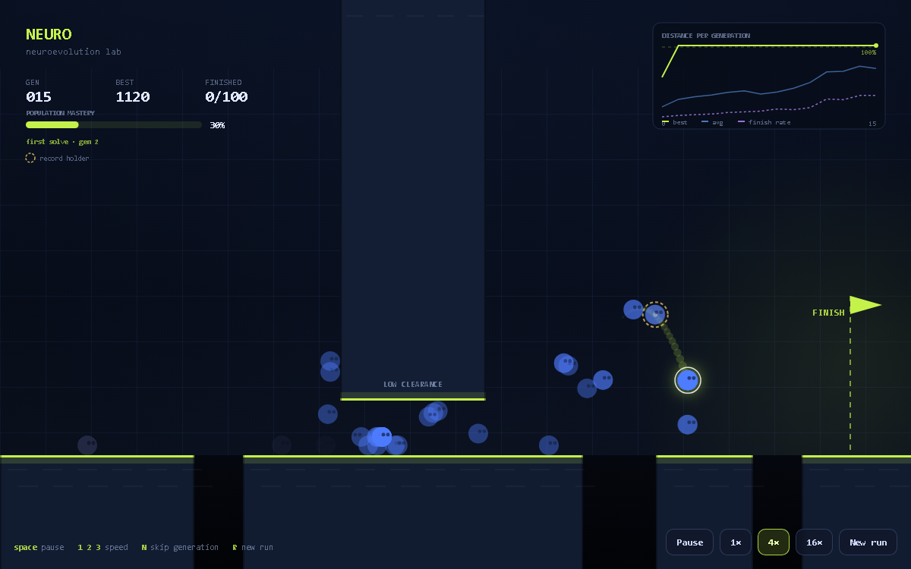
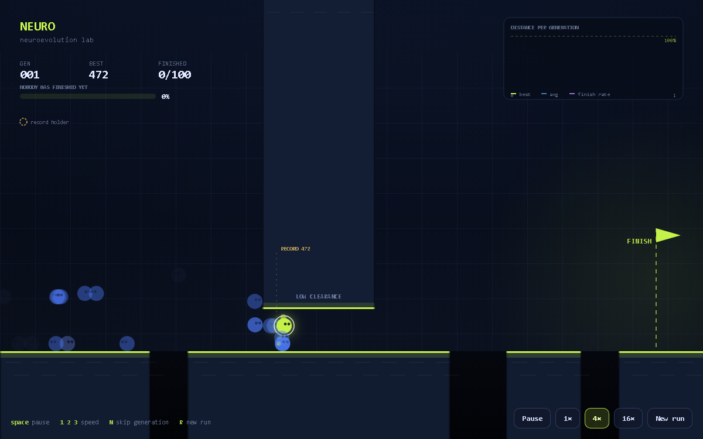

# NEURO — watch a population learn

[](https://github.com/larrybuckalew/neuro-lab/actions/workflows/tests.yml)

**▶ [Watch it run](https://larrybuckalew.github.io/neuro-lab/)** — nothing to install.

A neuroevolution lab in the browser. One hundred agents, each driven by its own
tiny neural network, are dropped onto the same obstacle course. They start by
falling over. Within a few generations one of them gets to the flag; within a few
dozen, most of them do.

Nothing is scripted. There is no training data and no backpropagation — only a
population, a fitness score, and selection.

You can also just open `index.html`. No build step, no dependencies, no API keys.



## What you're looking at

Each agent has eleven senses:

```
bias · speed · vertical speed · on the ground?
distance + height of the next wall
distance + width of the next pit
distance to the next low ceiling · currently under one?
height above the floor
```

Those feed a 11 → 12 → 2 network (`tanh`), which outputs two continuous values:
**how hard to run** and **whether to jump**. That's the whole creature.

Four things on screen are worth knowing how to read:

- **The gold dashed ring** is the record holder — the best genome so far — re-running
  every generation as a ghost. It isn't in the population and can't be selected, so
  there is always a visible answer to "what does a good run look like right now",
  even in generation 3 while most of the field is still stuck at the first wall.
- **Population mastery** is the number that matters. One creature clearing the course
  is luck; the bar is the share of the population that finished the last generation,
  and it climbing is the thing actually being demonstrated.
- **The dashed gold line** in the world is the furthest anyone has ever got. It moves
  right as the frontier moves, and it is the honest measure of progress when the
  chart is still flat.
- **The chart** tracks best distance, average distance, and finish rate. The average
  line is the laggard — the one that shows the whole population improving rather than
  one lucky mutant.

Every generation is 10 seconds. When it ends, the 100 agents are ranked by how far
they got (plus a bonus for finishing, and a bonus for finishing quickly). The top
six survive untouched, the rest are bred from tournament-selected parents with
uniform crossover and per-gene gaussian mutation, and 8% of each generation is
replaced with fresh random genomes to keep the gene pool from stagnating.

## Controls

| | |
| --- | --- |
| `Space` | pause / resume |
| `1` `2` `3` | 1× · 4× · 16× simulation speed |
| `N` | skip to the end of this generation |
| `R` | new run (new seed — a different learning path) |

The seed lives in the URL (`?seed=12345`), so a run is reproducible and shareable.

## Why the course looks like that

The low tunnel is the most important part of the level, and it exists for a
specific reason. Early builds were just walls and pits, and the headless harness
found that **"hold right and jump constantly" finishes the course 100 times out of
100**. There was nothing to learn, and evolution solved it in one generation.

A low ceiling fixes that: a grounded agent runs straight through, but anything
airborne clonks the roof, gets stunned, and loses its speed. Now jumping is not
free — it has to be *conditional* on what's ahead. That single obstacle turns a
trivial task into one where generation 1 scores 621px, generation 2 has its first
finisher, and it takes another forty generations before two thirds of the
population can do it.



## How it's built

Everything is in `index.html`: course, agent physics, the network, the genetic
algorithm, the renderer and the HUD. The simulation half has no DOM dependencies,
which is what lets the test harness run it headlessly.

- **Fixed timestep** of 1/60 s, with speed multipliers running 1/4/16 steps per
  rendered frame.
- **Seeded RNG** (mulberry32) for the genome initialisation, mutation and
  tournament sampling — same seed, same run, every time.
- **Collision** is AABB against a handful of rectangles, resolved on the axis of
  minimum penetration so agents can't be flung across a floor tile.
- **Canvas 2D** rendering, no WebGL, no libraries.

## Tests

`tools/converge.mjs` loads the page's script into a fake window, runs the
simulation with no renderer, and asserts the interesting things:

1. **It actually learns** — a creature finishes the course, and within 40
   generations.
2. **Determinism** — the same seed reproduces the same run; different seeds
   diverge.
3. **The ghost stays a ghost** — it carries the record genome, and it is not in
   the population, so it can never skew selection.
4. **No NaN/Infinity** anywhere in agent state.
5. **Throughput** — enough simulation steps per second to drive 16× rendering
   without dropping frames.

```sh
node tools/converge.mjs
```

The harness is what caught the two bugs worth mentioning: a collision pass that
teleported agents across entire ground segments, and an escape route where agents
could jump off the wall, land on the tunnel roof, and walk over the obstacle the
course was built around.

## Ideas

Speciation with fitness sharing, novelty search, a second hidden layer, a
procedurally generated course per seed, exporting and re-importing champion
genomes, or a slow-motion replay of the best run at the end of every generation.

## License

MIT
